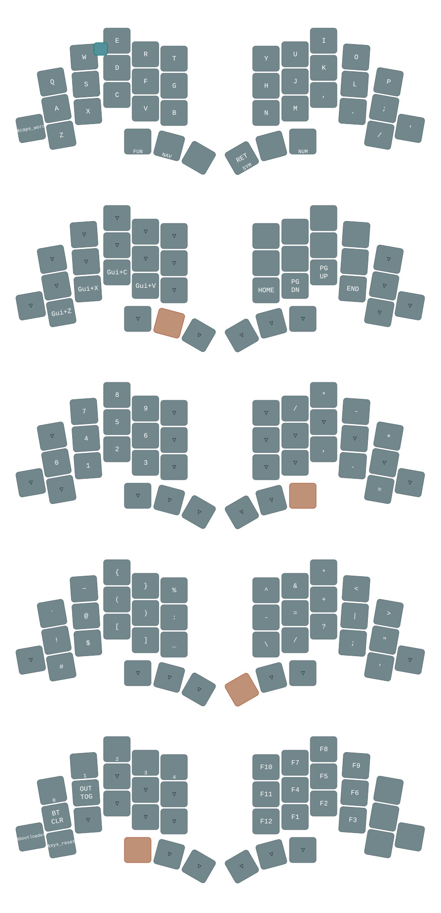

# zmk-totem firmware

Based on my QMK Corne Firmware  
https://github.com/rafaeldelboni/alphadel-crkbd-keymap

## Features
- Bilateral home-row mods (`hml`/`hmr`, CAGS: Ctrl Alt Cmd Shift from pinky to index), `balanced` flavor, `require-prior-idle-ms`, opposite-hand `hold-trigger-key-positions`
- Layer-taps on the thumbs: `ESC/FUN`, `BSPC/NAV`, `TAB` | `RET/SYM`, `SPACE`, `DEL/NUM`
- NAV: arrows + word/line jumps on the right hand, clipboard on the left; NUM: numpad on the left hand; SYM: bracket pairs stacked on middle+index
- `ESC` on the bottom-left pinky (where Ctrl/Esc used to be)

